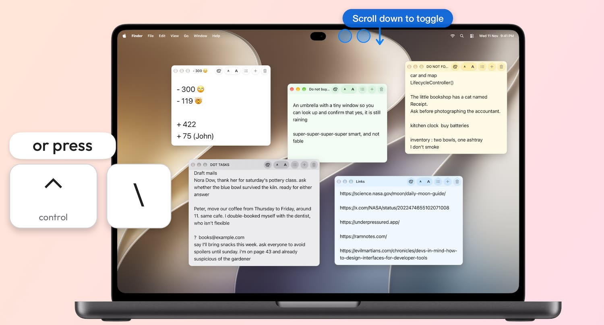

# RAMnotes

RAMnotes is sticky notes for your Mac. One shortcut shows your notes, and the same shortcut hides them. Each note is a text file, so your AI tools can read and edit it.

**[Visit ramnotes.com](https://ramnotes.com/)**

Read [RAM and notes](https://ramnotes.com/articles/ram-and-notes) for the ideas behind the app.

## Show and hide

- Control-Backslash shows or hides your open notes from any app.
- Or put the pointer on the menu bar and scroll.
- Control-Command-Backslash shows your open notes and the note list.
- You can change both shortcuts in Settings.
- Your notes open at the place where you stopped.
- RAMnotes has no Dock icon and no menu bar icon.

## Notes in an AI project

Example:

1. Save a note named `agent-inbox.txt` in your project folder.
2. Write tasks, links, and ideas in the note while you work.
3. Tell your AI tool to read the file. For example, refer to it in `AGENTS.md` or in a scheduled task.
4. The AI tool does the tasks and edits the file.
5. Open the note in RAMnotes to see the changes.

RAMnotes has no AI functions. It reads and writes the `.txt` file. Your AI tools do the other steps.

## Notes in any folder

A note can be in any folder on your Mac. Each note can be in a different folder.

- Set a default folder for new notes.
- Use **Move To** to put a note in another folder.
- Add a `.txt` file from Finder to edit it in place.

Your notes are ordinary `.txt` files. Other apps can read and change the same files. To sync your notes, set the default folder to a folder in iCloud Drive, Google Drive, Dropbox, or a similar service.

Editing an added note, or moving it to the Trash, affects the original file.

## Note windows

- Open several notes at once.
- **Always on top** keeps a note above other apps.
- Each note can have one of six color tints.
- Each note has its own text size. Change it with Command-Plus and Command-Minus.
- RAMnotes remembers the position of each window and your place in each note.
- RAMnotes saves your changes automatically.

## Search

- Command-F searches in the current note.
- Shift-Command-F searches all your notes.
- The note list has a search field.

## Settings

- Default notes folder
- Font, default text size, and line spacing
- Light or dark appearance
- Shortcuts
- Launch at login

## Privacy

RAMnotes does not connect to the internet. It needs no account and it collects no data. It reads and writes only the files and folders that you select.

## Limits

- Plain text only. No rich text, no Markdown preview, no tags, no notebooks.
- Notes must be UTF-8 `.txt` files.
- The note list shows files directly in the default folder and files that you add. It does not scan subfolders.
- RAMnotes has no sync service of its own.
- RAMnotes can miss a change from another app if that app keeps the file's modification timestamp.
- macOS can require a normal desktop Space to show notes over a fullscreen app.

## Languages

English, Spanish, Brazilian Portuguese, German, French, Arabic, Japanese, and Simplified Chinese.

RAMnotes uses your Mac's language settings. To choose a different language for RAMnotes, open **System Settings > General > Language & Region > Applications**. Restart RAMnotes after you change the language.

## Requirements

An Apple Silicon Mac with macOS 27.0 or later. RAMnotes does not support Intel Macs, iPhone, or iPad.

## Install

1. Get the RAMnotes disk image from [ramnotes.com](https://ramnotes.com/).
2. Open the `.dmg` file.
3. Drag **RAMnotes** to **Applications**.
4. Open RAMnotes from **Applications**.

The note list appears when you first open RAMnotes.

- Choose **New Note** to create a note.
- Choose **Add Existing Files** to add your text files.
- Click the gear button to open Settings. Choose your default notes folder there.

## Recover unsaved text

- If RAMnotes cannot save a note, the note window shows a warning.
- Use **Export** to save the text to an accessible location.
- Use **Restore File Access** or **Locate File** when the warning offers those actions.
- If another app changes a file while RAMnotes has unsaved edits, RAMnotes keeps your edits in a separate recovery note. Review both notes before you delete either file.

## Uninstall

1. Save or export any text that has a save warning.
2. Copy any notes you want to keep to a folder outside RAMnotes' app data.
3. Disable **Launch at login** in RAMnotes Settings if you enabled it.
4. Choose **Quit RAMnotes** in Settings.
5. Move **RAMnotes** from **Applications** to the Trash in Finder.

Moving the app to the Trash leaves its settings and stored data on your Mac. Files in other folders stay in those folders.

The initial default notes folder is inside the app's data container. That container also holds recovery data. Do not delete the container with a cleanup tool unless you first copy your notes and save any unsaved text.

## Help and feedback

Visit [ramnotes.com](https://ramnotes.com/) for more about RAMnotes.

To report a problem or suggest an improvement, [open a GitHub issue](https://github.com/a-dev/ramnotes/issues/new). Include your macOS version, RAMnotes version, and the steps that led to the problem. Remove private note text and personal file paths from screenshots and error messages.

## For developers

RAMnotes is open source under the [MIT License](LICENSE).

- [Contribute, build, and test](docs/contribution.md)
- [Documentation index](docs/README.md)
- [Product spec](docs/SPEC.md)
- [Architecture](docs/architecture.md)
- [Build and release](docs/build.md)
